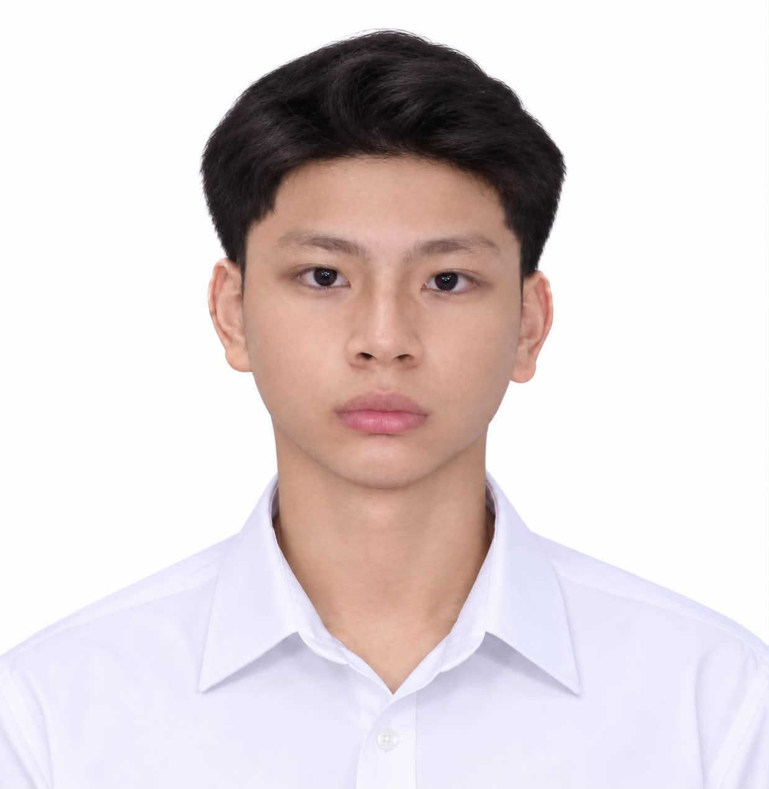

# Hi, I'm Joseph Anthony Feliciano! 👋

I'm a fourth-year Nursing student at Ateneo de Davao University. I enjoy exploring different interests, learning new skills, and improving myself both academically and personally.

Outside academics, I enjoy hiking, playing football, gaming, and activities related to health and fitness. I'm also interested in learning more about technology and developing my digital skills.

## Skills & Tools Learned 💻

Throughout this project, I developed practical skills in digital productivity, visual communication, design, and content creation through Activities 1–7.

### 🎨 Design & Creativity
- **Presentation Design:** Applying design principles, visual hierarchy, proper layouts, and effective presentation techniques.
- **Color Theory & Typography:** Selecting appropriate color combinations, pairing fonts, and developing consistent visual identities.
- **Graphic Design:** Creating visually appealing social media infographics through effective use of colors, typography, images, and layouts.
- **Visual Communication:** Organizing information into clear, engaging, and easy-to-understand visual content.

### 💻 Digital & Technical Skills
- **Website Creation:** Developing and organizing website content while learning the fundamentals of website presentation and structure.
- **Digital Content Creation:** Creating and organizing digital materials for different purposes and audiences.
- **Document and File Management:** Organizing project files, maintaining proper folder structures, and using meaningful file names.
- **GitHub & Markdown:** Creating repositories, uploading files, managing project folders, writing README documentation, and tracking changes through commits.

### 📄 Professional & Communication Skills
- **Online Collaboration:** Using Google Meet for virtual communication and collaboration.
- **Online Forms:** Creating and managing Google Forms for information collection and digital interaction.
- **Resume Development:** Organizing personal information, educational background, skills, and experiences into a professional resume.
- **Professional Presentation:** Learning how to present personal qualifications and information clearly and effectively.

### 🛠️ Tools & Platforms
- GitHub
- Markdown
- Google Meet
- Google Forms
- Digital presentation and graphic design tools
